<picture><source media="(prefers-color-scheme: dark)" srcset="assets/name-dark.svg"></picture>

<a href="mailto:zeroherolin@outlook.com"><samp>zeroherolin<wbr>@outlook.com</samp></a>

<picture><source media="(prefers-color-scheme: dark)" srcset="assets/stack-dark.svg">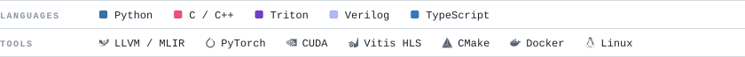</picture>

<picture><source media="(prefers-color-scheme: dark)" srcset="assets/section-projects-dark.svg">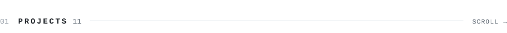</picture>

<!-- BEGIN projects (generated by scripts/render.py) -->
<pre><a
href="https://github.com/zeroherolin/sar-dsl"><picture><source media="(prefers-color-scheme: dark)" srcset="assets/projects/sar-dsl-dark.svg">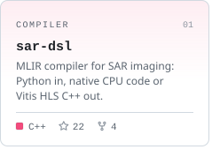</picture></a><a
href="https://github.com/zeroherolin/pytorch-sar"><picture><source media="(prefers-color-scheme: dark)" srcset="assets/projects/pytorch-sar-dark.svg">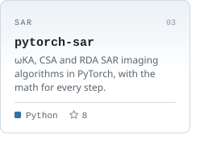</picture></a><a
href="https://github.com/zeroherolin/xdma-dma-sg"><picture><source media="(prefers-color-scheme: dark)" srcset="assets/projects/xdma-dma-sg-dark.svg">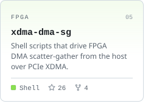</picture></a><a
href="https://github.com/zeroherolin/brushgraft"><picture><source media="(prefers-color-scheme: dark)" srcset="assets/projects/brushgraft-dark.svg">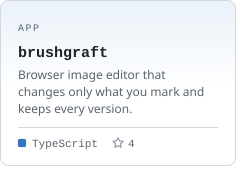</picture></a><a
href="https://github.com/zeroherolin/shellbot-harness"><picture><source media="(prefers-color-scheme: dark)" srcset="assets/projects/shellbot-harness-dark.svg">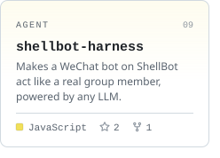</picture></a><a
href="https://github.com/zeroherolin/intelligent-computing-system"><picture><source media="(prefers-color-scheme: dark)" srcset="assets/projects/intelligent-computing-system-dark.svg">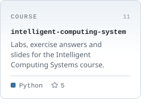</picture></a>
<a
href="https://github.com/zeroherolin/zl_bench"><picture><source media="(prefers-color-scheme: dark)" srcset="assets/projects/zl_bench-dark.svg">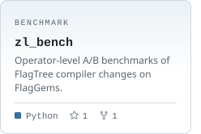</picture></a><a
href="https://github.com/zeroherolin/uart2axi"><picture><source media="(prefers-color-scheme: dark)" srcset="assets/projects/uart2axi-dark.svg">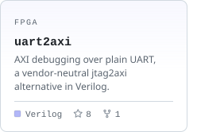</picture></a><a
href="https://github.com/zeroherolin/dma-sg-cxx-project"><picture><source media="(prefers-color-scheme: dark)" srcset="assets/projects/dma-sg-cxx-project-dark.svg">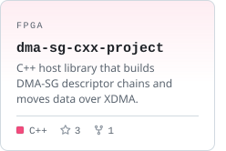</picture></a><a
href="https://github.com/zeroherolin/promptbrush"><picture><source media="(prefers-color-scheme: dark)" srcset="assets/projects/promptbrush-dark.svg">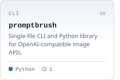</picture></a><a
href="https://github.com/zeroherolin/linspace"><picture><source media="(prefers-color-scheme: dark)" srcset="assets/projects/linspace-dark.svg"></picture></a></pre>
<!-- END projects -->

<picture><source media="(prefers-color-scheme: dark)" srcset="assets/section-forks-dark.svg"></picture>

<!-- BEGIN forks (generated by scripts/render.py) -->

<picture
><source media="(prefers-color-scheme: dark)" srcset="assets/forks/_llvm-mlir-dark.svg"></picture><picture
><source media="(prefers-color-scheme: dark)" srcset="assets/forks/_ml-compilers-dark.svg"></picture><picture
><source media="(prefers-color-scheme: dark)" srcset="assets/forks/_kernel-dsls-dark.svg"></picture><picture
><source media="(prefers-color-scheme: dark)" srcset="assets/forks/_kernel-libraries-dark.svg"></picture><a
 href="https://github.com/zeroherolin/llvm-project"><picture><source media="(prefers-color-scheme: dark)" srcset="assets/forks/llvm-project-dark.svg"></picture></a><a
 href="https://github.com/zeroherolin/tvm"><picture><source media="(prefers-color-scheme: dark)" srcset="assets/forks/tvm-dark.svg"></picture></a><a
 href="https://github.com/zeroherolin/triton"><picture><source media="(prefers-color-scheme: dark)" srcset="assets/forks/triton-dark.svg"></picture></a><a
 href="https://github.com/zeroherolin/cutlass"><picture><source media="(prefers-color-scheme: dark)" srcset="assets/forks/cutlass-dark.svg"></picture></a><a
 href="https://github.com/zeroherolin/Polygeist"><picture><source media="(prefers-color-scheme: dark)" srcset="assets/forks/Polygeist-dark.svg"></picture></a><a
 href="https://github.com/zeroherolin/tvm-tirx"><picture><source media="(prefers-color-scheme: dark)" srcset="assets/forks/tvm-tirx-dark.svg"></picture></a><a
 href="https://github.com/zeroherolin/tilelang"><picture><source media="(prefers-color-scheme: dark)" srcset="assets/forks/tilelang-dark.svg"></picture></a><a
 href="https://github.com/zeroherolin/DeepGEMM"><picture><source media="(prefers-color-scheme: dark)" srcset="assets/forks/DeepGEMM-dark.svg"></picture></a><a
 href="https://github.com/zeroherolin/mlir-emitc"><picture><source media="(prefers-color-scheme: dark)" srcset="assets/forks/mlir-emitc-dark.svg"></picture></a><a
 href="https://github.com/zeroherolin/torch-mlir"><picture><source media="(prefers-color-scheme: dark)" srcset="assets/forks/torch-mlir-dark.svg"></picture></a><a
 href="https://github.com/zeroherolin/FlagTree"><picture><source media="(prefers-color-scheme: dark)" srcset="assets/forks/FlagTree-dark.svg"></picture></a><a
 href="https://github.com/zeroherolin/FlashMLA"><picture><source media="(prefers-color-scheme: dark)" srcset="assets/forks/FlashMLA-dark.svg"></picture></a><a
 href="https://github.com/zeroherolin/pymlir"><picture><source media="(prefers-color-scheme: dark)" srcset="assets/forks/pymlir-dark.svg"></picture></a><a
 href="https://github.com/zeroherolin/iree"><picture><source media="(prefers-color-scheme: dark)" srcset="assets/forks/iree-dark.svg"></picture></a><picture
></picture><a
 href="https://github.com/zeroherolin/FlagGems"><picture><source media="(prefers-color-scheme: dark)" srcset="assets/forks/FlagGems-dark.svg"></picture></a><picture
></picture><a
 href="https://github.com/zeroherolin/Halide"><picture><source media="(prefers-color-scheme: dark)" srcset="assets/forks/Halide-dark.svg"></picture></a><picture
></picture><a
 href="https://github.com/zeroherolin/FlagGems-vllm"><picture><source media="(prefers-color-scheme: dark)" srcset="assets/forks/FlagGems-vllm-dark.svg"></picture></a><picture
><source media="(prefers-color-scheme: dark)" srcset="assets/forks/_llm-inference-dark.svg"></picture><picture
><source media="(prefers-color-scheme: dark)" srcset="assets/forks/_hardware-compilers-dark.svg"></picture><picture
><source media="(prefers-color-scheme: dark)" srcset="assets/forks/_fpga-radar-dark.svg"></picture><picture
><source media="(prefers-color-scheme: dark)" srcset="assets/forks/_learning-dark.svg"></picture><a
 href="https://github.com/zeroherolin/vllm"><picture><source media="(prefers-color-scheme: dark)" srcset="assets/forks/vllm-dark.svg"></picture></a><a
 href="https://github.com/zeroherolin/circt"><picture><source media="(prefers-color-scheme: dark)" srcset="assets/forks/circt-dark.svg"></picture></a><a
 href="https://github.com/zeroherolin/dma_ip_drivers"><picture><source media="(prefers-color-scheme: dark)" srcset="assets/forks/dma_ip_drivers-dark.svg"></picture></a><a
 href="https://github.com/zeroherolin/MLIR-Tutorial"><picture><source media="(prefers-color-scheme: dark)" srcset="assets/forks/MLIR-Tutorial-dark.svg"></picture></a><a
 href="https://github.com/zeroherolin/sglang"><picture><source media="(prefers-color-scheme: dark)" srcset="assets/forks/sglang-dark.svg"></picture></a><a
 href="https://github.com/zeroherolin/allo"><picture><source media="(prefers-color-scheme: dark)" srcset="assets/forks/allo-dark.svg"></picture></a><a
 href="https://github.com/zeroherolin/gtkwave"><picture><source media="(prefers-color-scheme: dark)" srcset="assets/forks/gtkwave-dark.svg"></picture></a><a
 href="https://github.com/zeroherolin/hands-on-practical-mlir-tutorial"><picture><source media="(prefers-color-scheme: dark)" srcset="assets/forks/hands-on-practical-mlir-tutorial-dark.svg"></picture></a><a
 href="https://github.com/zeroherolin/DeepInfer"><picture><source media="(prefers-color-scheme: dark)" srcset="assets/forks/DeepInfer-dark.svg"></picture></a><a
 href="https://github.com/zeroherolin/ScaleHLS-HIDA"><picture><source media="(prefers-color-scheme: dark)" srcset="assets/forks/ScaleHLS-HIDA-dark.svg"></picture></a><a
 href="https://github.com/zeroherolin/PLFM_RADAR"><picture><source media="(prefers-color-scheme: dark)" srcset="assets/forks/PLFM_RADAR-dark.svg"></picture></a><a
 href="https://github.com/zeroherolin/AdvancedCompiler"><picture><source media="(prefers-color-scheme: dark)" srcset="assets/forks/AdvancedCompiler-dark.svg"></picture></a><picture
></picture><a
 href="https://github.com/zeroherolin/pylog"><picture><source media="(prefers-color-scheme: dark)" srcset="assets/forks/pylog-dark.svg"></picture></a><picture
></picture><a
 href="https://github.com/zeroherolin/AISystem"><picture><source media="(prefers-color-scheme: dark)" srcset="assets/forks/AISystem-dark.svg"></picture></a><picture
></picture><picture
></picture><picture
></picture><a
 href="https://github.com/zeroherolin/ai-infra-book"><picture><source media="(prefers-color-scheme: dark)" srcset="assets/forks/ai-infra-book-dark.svg"></picture></a><picture
></picture><picture
></picture><picture
></picture><a
 href="https://github.com/zeroherolin/ai-agent-book"><picture><source media="(prefers-color-scheme: dark)" srcset="assets/forks/ai-agent-book-dark.svg"></picture></a><picture
><source media="(prefers-color-scheme: dark)" srcset="assets/forks/_ai-agents-dark.svg"></picture><picture
></picture><picture
></picture><picture
></picture><a
 href="https://github.com/zeroherolin/wechat-cli"><picture><source media="(prefers-color-scheme: dark)" srcset="assets/forks/wechat-cli-dark.svg"></picture></a><picture
></picture><picture
></picture><picture
></picture><a
 href="https://github.com/zeroherolin/catbus"><picture><source media="(prefers-color-scheme: dark)" srcset="assets/forks/catbus-dark.svg"></picture></a><picture
></picture><picture
></picture><picture
></picture><a
 href="https://github.com/zeroherolin/Godot-MCP-Native"><picture><source media="(prefers-color-scheme: dark)" srcset="assets/forks/Godot-MCP-Native-dark.svg"></picture></a><picture
></picture><picture
></picture><picture
></picture>

<!-- END forks -->

<picture><source media="(prefers-color-scheme: dark)" srcset="assets/section-languages-dark.svg"></picture>

<picture><source media="(prefers-color-scheme: dark)" srcset="assets/languages-dark.svg">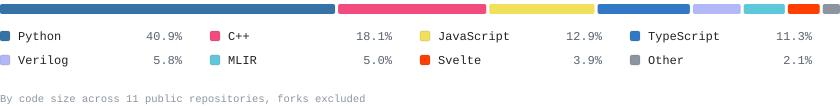</picture>
